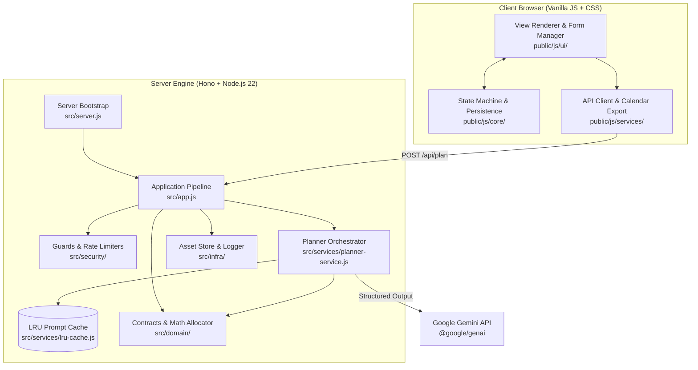

# ✨ EventCraft: AI Celebration & Event Planner

> **PromptWars · Challenge 5: Celebration & Event Planner**
>
> Enterprise-grade event architecture powered by Google Gemini.
>
> **Live demo:** <https://eventcraft.greenmeadow-4e76982d.centralindia.azurecontainerapps.io>

EventCraft transforms core details about any celebration—weddings, milestone birthdays, community gatherings, or custom festivities—into a comprehensive, realistic plan: a **deterministic budget allocation**, a **chronological milestone timeline**, a **prioritized vendor checklist**, and **curated creative themes**. Powered by Google Gemini with strict structured output and multi-turn conversational refinement.

---

## What EventCraft Delivers

| Challenge Need                                    | How EventCraft Fulfills It                                                                                                                                                                                                                                                                                        |
| ------------------------------------------------- | ----------------------------------------------------------------------------------------------------------------------------------------------------------------------------------------------------------------------------------------------------------------------------------------------------------------- |
| **Weddings, Birthdays, Community & Celebrations** | Purpose-built planning models: ceremonial traditions and seating for weddings; age-appropriate activities and themes for birthdays; safety, permits, and volunteer coordination for community festivals; adaptable presets for galas and anniversaries.                                                           |
| **Exact Mathematical Budgets**                    | Gemini proposes percentage distributions and contingency reserves (5–10%). Deterministic server code allocates exact integer currency units using the largest-remainder (Hamilton-Hare) method, guaranteeing allocations sum exactly to the total with zero roundoff error or overspend.                          |
| **Dated Milestone Timelines**                     | Tasks project backward from the event date into concrete UTC calendar days, culminating in a day-of run of the day schedule. Overdue items are flagged **Do now**, tasks can be ticked off with state saved in the browser, and full timelines export to `.ics` for Google Calendar, Outlook, and Apple Calendar. |
| **Prioritized Vendor Checklists**                 | Essential, recommended, and optional bookings organized with target lead times and actionable interview questions. Booking progress is tracked and saved locally.                                                                                                                                                 |
| **Personalized Creative Ideas**                   | Custom décor, menu concepts, entertainment, and keepsake suggestions tailored to guest demographics, season, venue, and cultural customs. Elements already secured by the user are excluded, and assumptions on unspecified details are stated transparently.                                                     |
| **Conversational Refinement**                     | Refine existing plans through plain-language dialogue (e.g., "Cut total expenditure by 20%", "Make catering vegan"). Ticked tasks and confirmed vendor bookings persist across revisions.                                                                                                                         |
| **Global Accessibility & Inclusion**              | Multi-language plan generation across 6 languages (English, Hindi, Spanish, French, German, Portuguese). Every plan factors in step-free physical access, dietary accommodations, low-waste sustainability, and outdoor weather contingencies.                                                                    |

---

## Core Focus Areas & Standards

### 1. Code Quality & Architectural Structure

- **Modular Layered Architecture**: Clean separation of concerns across `config/`, `domain/`, `services/`, `security/`, and `infra/` on the server, paired with `core/`, `services/`, and `ui/` on the frontend.
- **Type-Checked JavaScript**: Strict TypeScript verification of JSDoc types (`npm run typecheck`) in `strict` mode with zero errors. Shared data contracts between client and server.
- **Zero-Drift Contracts**: A single Zod plan schema serves as the single source of truth—generating Gemini's JSON Schema for structured output and validating client request/response bodies.
- **Dependency-Light**: Built on standard Node.js 22 built-ins (`node:test`, `node:crypto`, `node:zlib`, `node:fs`) and Hono with zero build steps or heavyweight bundles.

### 2. Problem Statement Alignment

- Directly addresses every dimension of PromptWars Challenge 5: weddings, milestone birthdays, community events, dynamic budgets with contingency buffers, countdown timelines, vendor management, and conversational refinement.
- Eliminates AI hallucinations in arithmetic by assigning judgment to Gemini and calculation to deterministic code.

### 3. Security & Safe Practices

- **Secret Isolation**: Gemini API keys stay exclusively on the server and are wiped from `process.env` immediately upon boot. Production supports read-only mounted secret files (`GEMINI_API_KEY_FILE`).
- **Automated Credential Masking**: Structured logger automatically scrubs configured keys and Google API key patterns (`AIza...`) from all stdout and stderr streams.
- **Strict Content Security Policy & Trusted Types**: Strict same-origin policy (`default-src 'self'`) with `require-trusted-types-for 'script'` and `trusted-types 'none'`. DOM nodes are assembled programmatically using `textContent` with zero `innerHTML` attack surface.
- **Anti-CSRF & Cross-Site Protection**: Rejects requests lacking same-origin validation (`Sec-Fetch-Site: cross-site`, mismatched `Origin`). All API responses send `Cache-Control: no-store` to prevent caching personal event data.
- **Input Sanitization**: Rejects control characters, Unicode directional override spoofing (`\u202A-\u202E`, `\u2066-\u2069`), oversized bodies (64 KB cap), and prototype pollution attempts (`__proto__`).
- **Prompt Injection Defense**: User content is transmitted to Gemini encapsulated in XML data tags (`<event>`, `<current_plan>`, `<feedback>`) with angle brackets systematically escaped to `\u003c` and `\u003e`.

### 4. Efficiency & Performance

- **Zero-I/O Static Serving**: Public assets are read and pre-compressed at startup into memory buffers for both Brotli (quality 11) and Gzip (level 9).
- **Strong ETags & Immutable Caching**: Content-derived version fingerprints enable `304 Not Modified` revalidation and year-long `immutable` client caching.
- **In-Memory LRU Prompt Cache**: SHA-256 prompt-keyed cache with TTL prevents redundant AI invocations for identical parameters.
- **Resilient Cascade Fallback**: If a primary model (`gemini-3.6-flash`) encounters transient throttling, the planner automatically falls back to secondary models (`gemini-3.5-flash-lite`).

### 5. Testing & Verification

- **100% Test Coverage**: Verified across lines, branches, and functions (`--test-coverage-lines=100 --test-coverage-branches=100 --test-coverage-functions=100`) across 141 tests.
- **Automated Accessibility Testing**: Full `axe-core` test suite enforcing WCAG 2.0, 2.1, and 2.2 Levels A, AA, and AAA plus best practices.
- **Live Model Evaluation (`npm run eval`)**: Suite testing live Gemini execution against sanity invariants (budget ceilings, contingency presence, Hindi script generation, injection immunity).

### 6. Accessibility (WCAG 2.2 AAA)

- **Visual Contrast**: Minimum 7:1 text contrast and 3:1 graphical control edge contrast across light, dark, and high-contrast modes.
- **Keyboard Navigation**: Complete keyboard operability, visible 3px focus rings, skip-to-content link, table keyboard scrollability (`tabindex="0"`), and automatic focus redirection on submission and undo.
- **Screen Reader Coordination**: Native semantic HTML5 landmarks (`header`, `main`, `section`, `nav`, `footer`), ARIA live regions (`role="status"`, `role="alert"`, `aria-live="polite"`), explicit label pairings, and localized language tagging (`lang="..."`).

---

## Layered Architecture



```text
src/
  server.js                   bootstrap: environment, logger, GenAI client, HTTP listener, signals
  app.js                      Hono pipeline: routes, rate limits, body limits, security headers, errors
  config/
    environment.js            Zod-validated environment & secret file configuration loader
  domain/
    constants.js              event types, currencies, priorities, languages, lead time horizons
    contracts.js              Zod contracts (EventSchema, PlanSchema, PlanRequestSchema, PLAN_JSON_SCHEMA)
    budget-allocator.js       deterministic largest-remainder (Hamilton-Hare) financial distribution
    scheduler.js              milestone scheduling, countdown timeline, and plan finalization
    chronos.js                UTC calendar-day math helpers
  services/
    planner-service.js        Gemini model orchestrator, model failover cascade, error translation
    prompt-synthesizer.js     system prompt & XML-delimited user prompt synthesis
    lru-cache.js              memory-bounded LRU prompt cache with TTL expiration
  security/
    rate-limiter.js           dual-tier fixed-window rate limiter & trusted proxy resolution
    protection-headers.js     strict Content Security Policy (Trusted Types), Permissions-Policy, HSTS
    cross-site-guard.js       Sec-Fetch-Site and Origin verification with Cache-Control: no-store
  infra/
    asset-store.js            in-memory pre-compressed static asset repository (Brotli/Gzip)
    structured-logger.js      structured JSON logging with automated credential redacting
    http-error.js             user-safe AppError with HTTP status codes and field maps
public/
  favicon.svg, index.html, styles.css, .well-known/security.txt
  js/
    main.js                   client entrypoint
    app.js                    UI controller & event delegation
    core/
      state-machine.js        pure state transitions (replacePlan, undo, setProgress)
      persistence.js          localStorage persistence with malformed data purging
      type-guards.js          runtime shape validators for API responses and saved plans
    services/
      api-client.js           POST /api/plan client with error mapping
      calendar-export.js      RFC 5545 iCalendar (.ics) export with UTF-8 byte folding
    ui/
      dom-builder.js          safe programmatic DOM node construction (el, byId)
      view-renderer.js        accessible view rendering (budget table, timeline, checklist, ideas)
      form-manager.js         HTML5 constraint validation, inline field error rendering, ARIA live
test/                         node:test suites (unit, integration, UI, accessibility) and live Gemini eval
```

---

## Quick Start

Requires Node.js 22.12 or later and a [Gemini API Key](https://aistudio.google.com/apikey).

```bash
npm ci
cp .env.example .env    # configure GEMINI_API_KEY
npm run dev             # launch at http://localhost:8080
```

### Available Scripts

| Command             | Action                                                                  |
| ------------------- | ----------------------------------------------------------------------- |
| `npm run check`     | Runs linter, typecheck, and test suite with 100% coverage verification  |
| `npm test`          | Executes unit, integration, UI, and accessibility tests via `node:test` |
| `npm run lint`      | Verifies Biome formatting and cognitive complexity constraints          |
| `npm run format`    | Automatically formats codebase with Biome                               |
| `npm run typecheck` | Strict TypeScript compilation verification on JSDoc types               |
| `npm run eval`      | Executes live evaluation against Google Gemini endpoints                |
| `npm start`         | Launches production server                                              |

### Configuration Reference

| Environment Variable           | Default                                  | Description                                            |
| ------------------------------ | ---------------------------------------- | ------------------------------------------------------ |
| `GEMINI_API_KEY`               | _(required if file unset)_               | Gemini API credential                                  |
| `GEMINI_API_KEY_FILE`          | _(unset)_                                | File path to mounted secret containing API key         |
| `GEMINI_MODELS`                | `gemini-3.6-flash,gemini-3.5-flash-lite` | Failover model priority cascade                        |
| `PORT`                         | `8080`                                   | HTTP listening port                                    |
| `RATE_LIMIT_PER_MINUTE`        | `10`                                     | Allowed requests per client IP per minute              |
| `GLOBAL_RATE_LIMIT_PER_MINUTE` | `120`                                    | System-wide ceiling protecting GenAI quota             |
| `TRUSTED_PROXIES`              | `0`                                      | Number of trusted reverse proxy hops for IP extraction |
